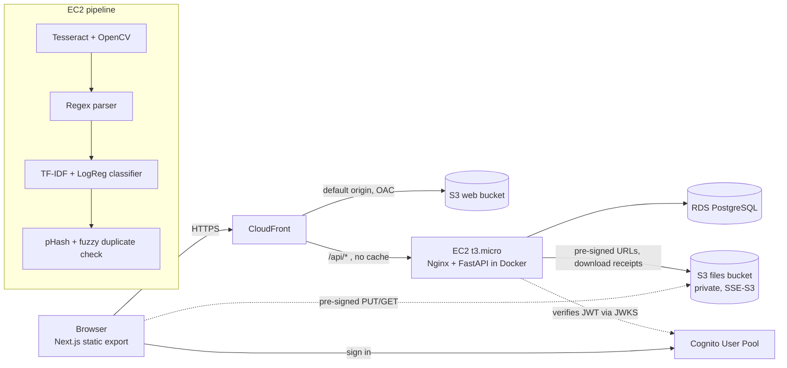

# TripVault

Cloud travel organizer: a document vault, day-by-day itinerary and Splitwise-style expense splitting, with receipt OCR.
Built for a Cloud Computing course (see the project proposal). **This build runs fully locally** (mock auth + MinIO, no AWS needed)
and is structured so the AWS deployment is a configuration change, not a rewrite.

## Architecture



**Pipeline:** 1 INGEST (browser gets a pre-signed URL, uploads straight to S3) → 2 STORE (private S3) → 3 PROCESS (API downloads the receipt, OCR → parse → classify → duplicate check) → 4 PERSIST (RDS PostgreSQL) → 5 SERVE (REST API + dashboard via CloudFront).

## Run locally

Prereqs: Docker, Node 20+.

```bash
cp .env.example .env
docker compose up --build            # Postgres + MinIO + API (migrates and seeds on start)

cd frontend
npm install
npm run dev                          # http://localhost:3000  (proxies /api -> localhost:8000)
```

Sign in with any seeded demo email (any password in mock mode): `elena.vance@tripvault.io` (owner), `aman.k@`, `david.m@`, `marcus.lin@tripvault.io`.
Any new email creates a new account. API docs: http://localhost:8000/api/docs · MinIO console: http://localhost:9001.

Backend without Docker (SQLite): `cd backend && pip install -r requirements.txt -r requirements-ml.txt && alembic upgrade head && python -m scripts.seed && uvicorn app.main:app --reload`
(file upload/OCR still needs MinIO or S3; OCR also needs the `tesseract` binary).

Tests: `cd backend && python -m pytest` (30 tests: settle-up, equal split, classifier, receipt parser, duplicate detector, OCR on `samples/receipts`, API authorization and flows).

## What's implemented

| Area | Notes |
|---|---|
| Auth | Cognito (email+password, sign-up with email code, forgot password) or local mock mode. Backend verifies the Cognito JWT via JWKS. |
| Roles | owner / editor / viewer enforced on every trip endpoint; non-members get 404. Invite by email (claimed on first sign-in), role changes, remove, copy link. |
| Vault | Folders (Flights, Hotels, Tickets, Passport, Other), drag-and-drop, pre-signed upload/download, type/size validation (images, PDF, `.pkpass`, ≤10 MB), grid/list, sort. |
| Itinerary | Day-grouped timeline with add/edit/delete. |
| Expenses | Equal or custom splits (exact to the cent), category donut, daily line chart, budget insights, CSV export. |
| Settle-up | Greedy debt minimisation (≤ n-1 payments); "Settle up" records the payment. |
| Scan receipt | Upload → OCR → editable fields → suggested category → duplicate warning → split → save. |
| Extras | Checklist with progress, Leaflet/OpenStreetMap map, photos gallery, ⌘K search, notifications, dark mode, live weather + FX (Open-Meteo / open.er-api.com), CSV export. |

## ML components (honest notes)

- **OCR:** Tesseract via pytesseract with OpenCV preprocessing (upscale, denoise, deskew, adaptive threshold). EasyOCR needs far more than 1 GB RAM, so it isn't used. Accuracy depends on photo quality; the form always lets the user correct fields.
- **Classifier:** TF-IDF (char n-grams) + Logistic Regression trained on `backend/app/ml/data/expense_categories.csv` (≈300 small synthetic rows), with a keyword-rule fallback under 40% confidence. **The 100% test accuracy printed by the training script is not meaningful**: the dataset is tiny and has near-duplicate rows across the train/test split. For the report, collect real labelled receipts and evaluate on held-out merchants. Retrain: `python -m scripts.train_classifier`.
- **Duplicates:** 64-bit perceptual hash (Hamming ≤ 6) + fuzzy match on amount (±0.01), date (±1 day) and merchant name.
- **Recommendations:** rule-based (remaining budget ÷ days left, category share, average daily spend). Not a learned model.
- **Receipts as PDF** are stored but can't be scanned (OCR is image-only).

## Deploy to AWS (region ap-south-1)

Do these once the local build works. Files are in `infra/`.

1. **Files bucket (S3):** create, Block Public Access ON, default encryption SSE-S3, CORS from `infra/s3-cors-files.json` (use your CloudFront domain after step 7).
2. **Web bucket (S3):** separate, private, Block Public Access ON.
3. **Cognito:** User Pool (email sign-in, email verification). Create an App client **without a secret**. Note the Pool ID and Client ID. (Google sign-in and passkeys are optional extras and are not wired in the UI.)
4. **RDS PostgreSQL:** `db.t4g.micro`, not publicly accessible. Security group: allow 5432 **only from the EC2 security group**.
5. **EC2 t3.micro (Ubuntu):** attach an IAM role using `infra/iam-ec2-s3-policy.json` (replace the bucket name). **No access keys on the box.** Run `infra/ec2-setup.sh`. Create `~/tripvault/backend/.env` from `backend/.env.example` with `APP_ENV=production`, `AUTH_MODE=cognito`, the RDS `DATABASE_URL`, `S3_BUCKET`, Cognito IDs, `CORS_ORIGINS=https://<cloudfront-domain>`, and **leave `S3_ENDPOINT_URL` and `S3_PUBLIC_ENDPOINT_URL` empty**. Then `EC2_HOST=ubuntu@<ip> ./infra/deploy-backend.sh`.
6. **Seed (optional):** demo users use fake IDs and can't sign in via Cognito; skip seeding in production.
7. **CloudFront:** follow `infra/cloudfront-notes.md` (two origins, OAC, the directory-index function, `/api/*` to EC2 with caching disabled).
8. **Frontend:** `WEB_BUCKET=... CF_DISTRIBUTION_ID=... NEXT_PUBLIC_COGNITO_USER_POOL_ID=... NEXT_PUBLIC_COGNITO_APP_CLIENT_ID=... ./infra/deploy-frontend.sh`.

Gotchas: the 1 GB t3.micro needs the swap file `ec2-setup.sh` creates; OCR of large photos takes a few seconds. EC2 → CloudFront uses HTTP on port 80, so restrict that security-group rule to CloudFront's prefix list.

## Cost control and cleanup

Free-plan credits are limited. Stop EC2 and RDS when not demoing (RDS auto-restarts after 7 days), set an AWS Budget alert, and avoid NAT gateways and Elastic IPs left unattached.
To tear down: delete the CloudFront distribution (disable first), empty then delete both S3 buckets, delete RDS (skip final snapshot if not needed), terminate EC2, delete the Cognito pool and IAM role.

## Serverless vs containerized (proposal question)

| | EC2 + Docker (this build) | Lambda + API Gateway |
|---|---|---|
| Fit for OCR/ML | Good: Tesseract/OpenCV/sklearn installed once, warm | Needs a container image or layers; cold starts of several seconds |
| Cost at low traffic | Fixed small monthly cost | Near zero |
| Scaling | Manual (one box) | Automatic |
| Ops | You patch and monitor the VM | Managed |
| DB connections | Simple pooled connections | Needs RDS Proxy to avoid exhausting connections |

For a demo/course project, the container is simpler and cheaper to reason about; Lambda (or Textract for OCR) is the natural production evolution.

## Known limits and scope changes

- **Not built from the proposal:** native mobile app, offline-first sync and real-time push (the site is responsive, installable as a PWA shell, and refreshes on navigation). Firebase was replaced by AWS per the build spec; TensorFlow by scikit-learn.
- **Security wording:** files are encrypted at rest in S3 (AES-256) and are *not* end-to-end encrypted. The Passport "device lock" uses WebAuthn as an app-level gate only.
- **UI-only items:** the language selector stores a preference but the UI is English-only; the "remember device" and passkey-sign-in controls from the design are not functional; Google sign-in needs Cognito hosted UI setup.
- **Covers:** trip covers are generated gradients (no stock photos).
- **Not production-hardened:** no rate limiting, no audit log, no malware scan on uploads, invites send no email (the invitee just needs to sign in with that address).
